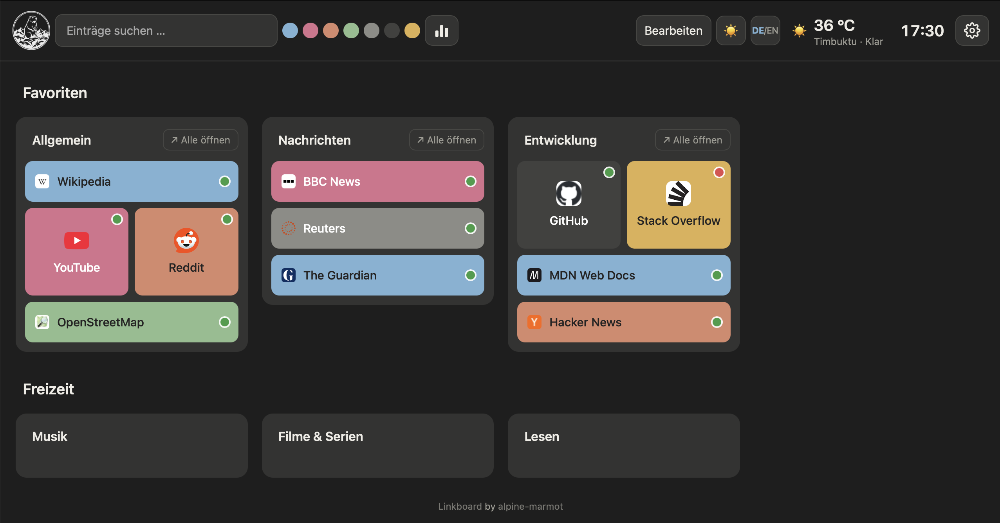
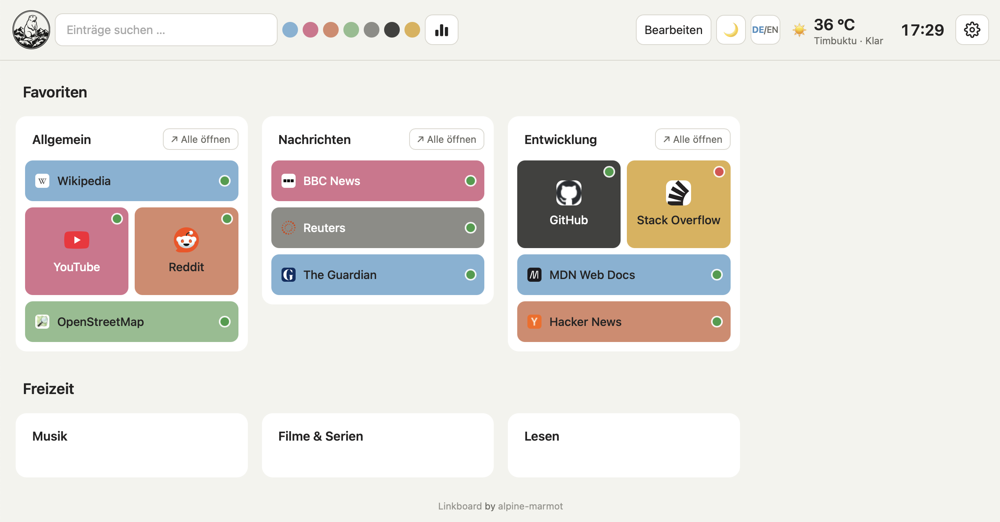
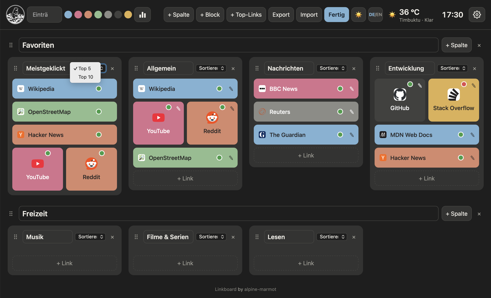
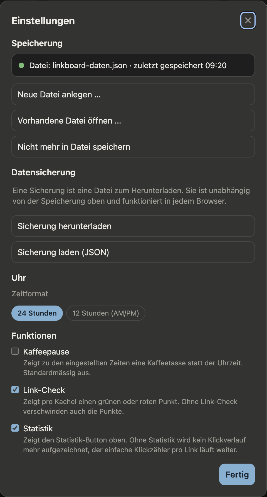
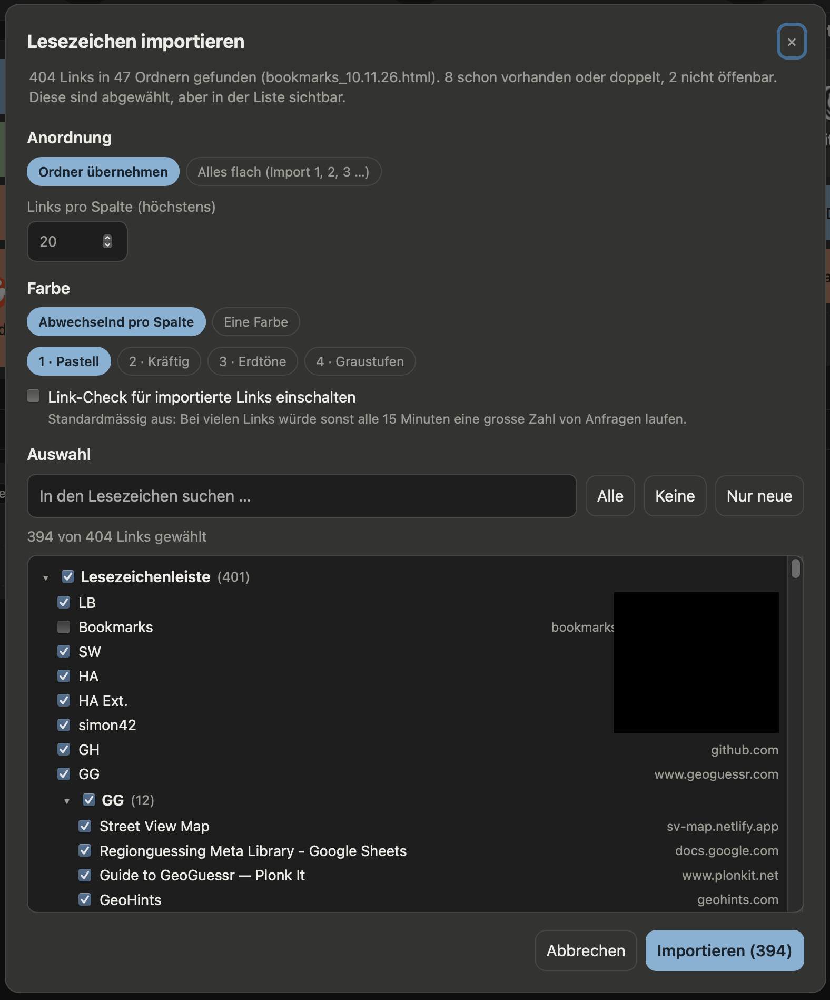
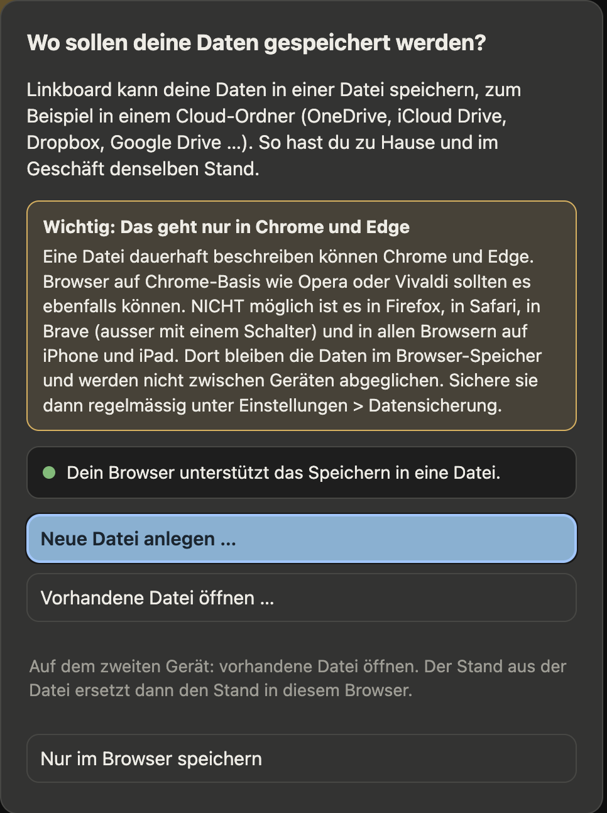

# Linkboard

Deutsch · [English](README.md)

Eine Browser-Startseite in einer einzigen Datei: deine Links als farbige Kacheln, gegliedert in Blöcke und Spalten, dazu Wetter, Uhr und Suchleiste. Kein Build-Schritt, kein Framework, kein Konto. Alles wird in deinem Browser gespeichert.

> **Wichtig, wenn du Safari nutzt:** Safari löscht die gespeicherten Daten einer Website (auch deine Links) nach 7 Tagen Safari-Nutzung, in denen du auf dieser Website nicht geklickt oder getippt hast. Bei der gehosteten Version über GitHub Pages können deine Links deshalb verschwinden. Nutze in Safari bitte die **heruntergeladene `index.html`, die du von deinem Computer aus öffnest**, statt den GitHub-Link, und mache ab und zu einen **Export**. Die 7-Tage-Regel ist für Websites dokumentiert. Für lokale Dateien haben wir keine Bestätigung gefunden, dass sie gilt, ihr Verhalten in Safari ist aber auch nicht offiziell dokumentiert, deshalb bleiben regelmässige Exporte ratsam. Details: *Daten und Datenschutz*.

## Screenshots

## Funktionen

- **Link-Kacheln** mit Name, Adresse und Farbe (4 Farbpaletten, darunter Graustufen, plus freie Farbwahl), Öffnen in einem neuen Tab. Es geht **nicht nur um Webadressen**: auch E-Mail, Telefon, Dateien, Ordner und Apps sind möglich (siehe *Link-Arten*)
- **Zwei Kachelformen**: breite Buttons oder quadratische Kacheln (zwei pro Reihe, so hoch wie zwei breite Buttons)
- **Blöcke → Spalten → Kacheln**, alle mit editierbaren Titeln und Drag-and-Drop (auch auf Touchscreens)
- **Sortieren** pro Spalte: A–Z, nach Farbe oder nach meisten Klicks; Filter nach Farbe; Live-Suche (Enter öffnet den ersten Treffer)
- **Top-Links-Kachel**: zeigt die meistgeklickten Links, Top 5 oder Top 10
- **Alle öffnen**: Ein Button im Kopf jeder Spalte öffnet alle Links dieser Spalte mit einem Klick in neuen Tabs (jeder zählt als Klick; der Browser fragt eventuell, ob Pop-ups erlaubt sind)
- **Lesezeichen-Import**: **Lesezeichen** (Bearbeitungsmodus) liest auch Lesezeichen-Dateien (HTML) aus Chrome, Edge, Firefox und Safari. Übernommen werden Web-, E-Mail-, Telefon- und App-Links (nicht `javascript:`, `data:`, `file:`, `chrome:`, `about:` und ähnliche). Du wählst die Links aus und übernimmst entweder die Ordnerstruktur (Ordner wird Block, Unterordner wird Spalte) oder legst alles flach in Spalten zu 20 an ("Import 1, 2, 3 …"); bereits vorhandene Links sind abgewählt
- **Link-Check**: ein optionaler grüner oder roter Punkt zeigt, ob der Server eines Links antwortet (nicht, ob die Seite selbst existiert); pro Link oder global in den Einstellungen abschaltbar
- **Statistik**: eine Diagrammansicht (Balken-Symbol neben den Farbpunkten) zeigt die meistgeklickten Links und den Klickverlauf pro Tag, Woche oder Monat; gezählt werden nur Klicks über diese Seite; in den Einstellungen abschaltbar (dann wird kein Tagesverlauf mehr aufgezeichnet)
- **Wetter und Aussentemperatur** oben rechts (Open-Meteo, kein API-Schlüssel); per Klick änderst du den Ort
- **Digitale Uhr** (24 h oder 12 h AM/PM)
- **Kaffeepause** (optional, standardmässig aus): zeigt zu den eingestellten Zeiten (Standard 09:30 und 15:00) eine Tasse mit Dampf-Animation für eine Minute, auf Wunsch mit kurzem Signalton. Einschalten in den Einstellungen unter *Funktionen*
- **Einstellungen** (Zahnrad oben rechts): Uhrformat; unter *Funktionen* Kaffeepause (mit Zeiten und optionalem Ton), Link-Check und Statistik jeweils ein/aus
- **Zwei Sprachen**: Die Oberfläche gibt es auf Deutsch und Englisch (Button **DE/EN** neben dem Hell/Dunkel-Umschalter; beim ersten Start gilt die Browsersprache). Deine eigenen Block-, Spalten- und Linknamen werden nie übersetzt
- **Dunkles und helles Design**
- **Responsiv**, nutzt die volle Browserbreite
- **Speicherung in einer Datei** (nur Chrome und Edge): Linkboard speichert deine Daten auf Wunsch in einer Datei, zum Beispiel in einem Cloud-Ordner, und gleicht sie zwischen zwei Geräten ab (siehe *Speicherung und Abgleich*). Beim ersten Start fragt Linkboard danach
- **Datensicherung** (Einstellungen): Sicherung als JSON-Datei herunterladen und wieder laden, in jedem Browser

## Link-Arten

Eine Kachel muss kein Link auf eine Webseite sein. Linkboard übergibt die Adresse unverändert an den Browser, und der öffnet sie selbst oder reicht sie ans Betriebssystem weiter. Ohne Angabe wird `https://` ergänzt, für `localhost`, IP-Adressen und `.local`-Namen `http://`.

| Art | Beispiel |
| --- | --- |
| Webseite | `https://example.org`, `example.org`, `http://192.168.1.20:8123`, `nas.local/admin` |
| E-Mail | `mailto:name@example.org?subject=Hallo` |
| Telefon, SMS | `tel:+41791234567`, `sms:+41791234567` |
| Lokale Datei oder Ordner | `file:///Users/name/Dokumente/plan.pdf`, `file:///C:/Daten/` |
| Dateiserver, Fernzugriff | `smb://nas/freigabe`, `ftp://files.example.org`, `ssh://server`, `vnc://10.0.0.5` |
| Apps (Adresse mit `//`) | `obsidian://open?vault=Notizen`, `steam://run/730`, `zoommtg://zoom.us/join?confno=123`, `slack://open` |
| Apps (Adresse ohne `//`) | `spotify:playlist:<ID>`, `facetime:+41791234567`, `skype:name?call`, `maps:?q=Bern`, `geo:46.95,7.45` |

Gut zu wissen:

- **Die App muss installiert sein**, sonst passiert nichts oder der Browser meldet einen Fehler. Chrome, Edge und Safari fragen bei den meisten fremden Programmen zuerst um Erlaubnis. Das lässt sich von der Seite aus nicht umgehen.
- **Lokale Dateien** (`file://`) öffnen sich nur zuverlässig, wenn du Linkboard als lokale Datei nutzt. Von einer Webseite (zum Beispiel GitHub Pages) aus blockieren Browser solche Links meistens.
- **Nicht erlaubt** sind `javascript:`, `data:`, `vbscript:` und `blob:` (aus Sicherheitsgründen). Interne Browserseiten wie `chrome://` oder `about:` können Browser von einer Webseite aus nicht öffnen.
- **Link-Check, Favicon und "Alle öffnen"** gibt es nur bei Web-Links (`http`, `https`). Andere Kacheln haben keinen Punkt und kein Webseiten-Symbol.
- Adressen mit Passwort oder Token (zum Beispiel `https://benutzer:geheim@…`) gehören nicht in eine Kachel, siehe *Daten und Datenschutz*.

## Speicherung und Abgleich

Standardmässig speichert Linkboard im Speicher des Browsers (siehe *Daten und Datenschutz*). Damit hast du zu Hause und im Geschäft zwei getrennte Stände. In **Chrome und Edge** kannst du stattdessen eine Datei wählen, zum Beispiel in einem Ordner, den OneDrive, iCloud Drive, Dropbox oder Google Drive abgleicht. Linkboard schreibt jede Änderung in diese Datei.

**Welche Browser können das?**

| Browser | Speichern in eine Datei |
| --- | --- |
| Chrome, Edge (ab Version 86), Chrome für Android (ab Version 132) | ja |
| Opera, Vivaldi und andere Browser auf Chrome-Basis | sollten ja, nicht getestet |
| Firefox | **nein** |
| Safari | **nein** |
| Brave | nur mit einem Schalter in den Browser-Einstellungen |
| Alle Browser auf iPhone und iPad | **nein**, nach unserem Kenntnisstand, weil dort alle Browser die Technik von Apple nutzen |

Wo es nicht geht, bleiben die Daten im Browser-Speicher. Nutze dann regelmässig die **Datensicherung** in den Einstellungen. Beim ersten Start zeigt Linkboard diese Übersicht und sagt dir, ob dein Browser es kann.

**So gehst du vor:**

1. Beim ersten Start erscheint eine Meldung. Wähle **Neue Datei anlegen …** und lege die Datei in deinem Cloud-Ordner ab (Vorschlag: `linkboard-daten.json`). Deine bisherigen Daten werden in die Datei übernommen.
2. Auf dem zweiten Gerät wählst du **Vorhandene Datei öffnen …** und nimmst dieselbe Datei. Der Stand aus der Datei ersetzt dann den Stand in diesem Browser.
3. Unter *Einstellungen*, *Speicherung* siehst du, wohin gespeichert wird und wann zuletzt. Dort wechselst du die Datei oder schaltest die Dateispeicherung wieder aus.

**Wichtig zu wissen:**

- **Was wird abgeglichen?** Blöcke, Spalten, Kacheln und Klickzähler. Einstellungen wie Uhr, Kaffeepause, Sprache, Farbpalette, Hell/Dunkel und Wetterort gelten pro Gerät.
- **Zugriff nach einem Neustart:** Der Browser lässt Linkboard nach dem Schliessen des Tabs nicht automatisch weiter in die Datei schreiben. Linkboard zeigt dann oben eine Leiste mit **Zugriff erlauben**. Ein Klick genügt.
- **Wenn die Datei neuer ist:** Hast du auf dem anderen Gerät etwas geändert, fragt Linkboard beim Start, welchen Stand du verwenden willst (Datei laden oder den Stand dieses Browsers behalten). Beide Geräte gleichzeitig zu bearbeiten wird nicht zusammengeführt: Es gilt immer ein ganzer Stand.
- **Der Cloud-Dienst gleicht die Datei ab, nicht Linkboard.** Linkboard sendet nichts an einen Anbieter. Warte, bis der Cloud-Dienst die Datei aktualisiert hat, bevor du auf dem anderen Gerät öffnest.
- **Die Datei ist JSON im Klartext** (mit einem zusätzlichen Zeitstempel). Du kannst sie zugleich als Sicherung verwenden.
- **Lokal geöffnete Datei (`file://`):** Ob der Browser das Speichern in eine Datei auch dort erlaubt, haben wir nicht abschliessend geprüft. Wenn es bei dir nicht geht, nutze die GitHub-Pages-Version oder die Datensicherung.

## Schnellstart

1. `index.html` herunterladen.
2. Im Browser öffnen.
3. Oben rechts auf **Bearbeiten** klicken, um Blöcke, Spalten und Links anzulegen.
4. Optional: die Datei als Startseite des Browsers eintragen, z. B. `file:///Pfad/zu/index.html`.

Du kannst die Seite auch mit **GitHub Pages** veröffentlichen (Settings → Pages → Deploy from branch `main`, Ordner `/root`) und diese Adresse als Startseite nutzen. Für Safari nicht empfohlen: siehe den Hinweis ganz oben.

## Bedienung

| Was | Wie |
| --- | --- |
| Etwas hinzufügen / ändern / löschen | **Bearbeiten** klicken, dann die Buttons in Kopfzeile, Blöcken, Spalten und Kacheln benutzen |
| Kacheln, Spalten, Blöcke verschieben | Bearbeitungsmodus, Drag-and-Drop (Touchscreen: kurz gedrückt halten) |
| Spalte sortieren | Bearbeitungsmodus, Menü „Sortieren“ im Spaltenkopf |
| Einstellungen (Uhr, Kaffeepause, Link-Check, Statistik) | auf das Zahnrad oder die Uhr klicken |
| Sprache umschalten | auf den Button **DE/EN** neben dem Hell/Dunkel-Umschalter klicken |
| Wetterort | auf das Wetter klicken |
| Statistik | auf das Balken-Symbol neben den Farbpunkten klicken |
| Alle Links einer Spalte öffnen | im Spaltenkopf auf *Alle öffnen* klicken (nicht im Bearbeitungsmodus) |
| Browser-Lesezeichen importieren | Bearbeitungsmodus, **Lesezeichen**, exportierte `.html`-Datei wählen, Links auswählen, **Importieren** |
| Daten zwischen Geräten abgleichen | Einstellungen, *Speicherung*, **Neue Datei anlegen …** oder **Vorhandene Datei öffnen …** (nur Chrome und Edge) |
| Sicherung | Einstellungen, *Datensicherung*, **Sicherung herunterladen** / **Sicherung laden (JSON)** |

## Daten und Datenschutz

*Stand: November 2026. Technische Beschreibung, keine Rechtsberatung. Bitte prüfe die aktuellen Bedingungen der unten genannten Dienste selbst.*

Linkboard hat keinen eigenen Server. Der Autor erhält, sammelt und speichert keine Daten. Alles, was du eingibst, bleibt in deinem Browser, abgesehen von den Anfragen an Drittdienste, die weiter unten aufgeführt sind.

### Auf einen Blick

| Was | Verlässt deinen Browser? |
| --- | --- |
| Deine Links, Namen, Titel, Farben, Klickzähler, Statistik, Einstellungen | **Nein.** Sie werden nur lokal gespeichert. |
| Hostname jedes Web-Links (nur `http`, `https`) | **Ja**, an den Favicon-Dienst von Google (für das Symbol) |
| Wetterort (Koordinaten; Name nur bei Ortswechsel) | **Ja**, an Open-Meteo. Ohne eigene Wahl sind es die Koordinaten von Bern. |
| Bibliothek SortableJS | wird von cdnjs/Cloudflare **geladen** (Anfrage mit deiner IP-Adresse) |
| Anfrage an jeden Web-Link mit eingeschaltetem Link-Check | **Ja**, direkt an den Zielserver |
| Datei, die du in Chrome oder Edge wählst | **Nicht durch Linkboard.** Linkboard schreibt nur in diese Datei. Liegt sie in einem Cloud-Ordner, überträgt der Cloud-Dienst sie nach seinen eigenen Regeln. |
| Kaffeepause und Signalton | **Nein.** Reine Browserfunktion, es wird nichts angefragt. |
| E-Mail-, Telefon-, Datei- und App-Links | **Nein**, bis du sie anklickst. Dann übernimmt Browser oder Betriebssystem. |

### Was wird wo gespeichert?

Linkboard speichert seine Daten im **lokalen Speicher** deines Browsers (`localStorage`) als Klartext (JSON). Sonst wird nichts geschrieben, und die Seite selbst setzt keine Cookies. Beim Abruf von Drittdiensten (siehe unten) können diese nach ihren eigenen Regeln Cookies setzen; ob der Browser sie annimmt, hängt von deinen Einstellungen für Drittanbieter-Cookies ab.

- `startseite-v1`: Blöcke, Spalten und Kacheln (Name, Adresse, Farbe, Form, Link-Check ein/aus), Klickzähler und tägliche Klickhistorie. Adressen wie `mailto:` oder `tel:` können Namen, E-Mail-Adressen und Telefonnummern **anderer Personen** enthalten
- `startseite-v1-chk`: Ergebnisse des Link-Checks (Adresse, erreichbar ja/nein, Zeitpunkt der Prüfung)
- `startseite-v1-settings`: Einstellungen (Uhrformat, Kaffeepause ein/aus mit Zeiten und Ton, Link-Check ein/aus, Statistik ein/aus)
- `startseite-v1-lang`: Oberflächensprache (`de` oder `en`)
- `startseite-v1-store`: Speicherart (`browser` oder `file`)
- `startseite-v1-ts`: Zeitpunkt der letzten Änderung (für den Vergleich mit der Datei)
- IndexedDB `linkboard-fs`: nur wenn du eine Datei gewählt hast; sie enthält einen Verweis auf diese Datei (nicht ihren Inhalt), damit Linkboard sie nach einem Neustart wiederfindet
- `startseite-v1-loc`: Wetterort (Name und Koordinaten), nur nachdem du ihn geändert hast
- `startseite-v1-pal`, `startseite-v1-theme`: Farbpalette und helles/dunkles Design

Das bedeutet:

- Die Daten gehören zu einem Browser, einem Browserprofil, einem Gerät und einer Seitenadresse. Linkboard in Chrome und in Firefox, oder als lokale Datei und über GitHub Pages geöffnet, hat getrennte Daten. Mit der Speicherung in einer Datei (nur Chrome und Edge) oder mit einer Sicherung (Einstellungen, *Datensicherung*) nimmst du sie mit.
- Nach unserem Kenntnisstand verschlüsseln Browser den lokalen Speicher nicht selbst. Wer Zugriff auf dein Benutzerkonto oder auf einen unverschlüsselten Datenträger hat, kann ihn lesen. Nutze getrennte Benutzerkonten und eine Festplattenverschlüsselung (zum Beispiel BitLocker oder FileVault).
- Die Sicherungs- und die Speicherdatei sind JSON im Klartext und enthalten alle Links und die Klickhistorie. Bewahre sie entsprechend auf, besonders in einem Cloud-Ordner, auf den auch andere zugreifen können.
- Lege keine Passwörter, Tokens oder andere Geheimnisse in Link-Adressen ab (auch nicht in Form von `https://benutzer:passwort@…` oder geheimen Freigabe-Links). Sie stehen im Klartext im lokalen Speicher, in der Export-Datei und werden beim Anklicken an die Zielseite gesendet.
- Wenn du Kacheln mit `mailto:` oder `tel:` für andere Personen anlegst, speicherst du deren Personendaten. Das ist für den privaten Gebrauch meist unproblematisch, im Betrieb aber datenschutzrelevant (siehe *Schweizer Datenschutzrecht*).
- Private Fenster behalten die Daten nach dem Schliessen nicht.
- Synchronisierungsfunktionen der Browser übertragen den lokalen Speicher normalerweise nicht. Das ist nicht garantiert, prüfe bei Bedarf die Sync-Einstellungen deines Browsers.

### Speicherort je Browser

Die Pfade sind Beispiele für das Standardprofil. Der Profilordner kann anders heissen (zum Beispiel `Profile 1`). Die Dateien sind nicht dafür gedacht, von Hand geöffnet zu werden.

**Google Chrome** (Ordner `Local Storage/leveldb`)
- Windows: `%LOCALAPPDATA%\Google\Chrome\User Data\Default\Local Storage\leveldb\`
- macOS: `~/Library/Application Support/Google/Chrome/Default/Local Storage/leveldb/`
- Linux: `~/.config/google-chrome/Default/Local Storage/leveldb/`

**Microsoft Edge** (gleicher Aufbau wie Chrome)
- Windows: `%LOCALAPPDATA%\Microsoft\Edge\User Data\Default\Local Storage\leveldb\`
- macOS: `~/Library/Application Support/Microsoft Edge/Default/Local Storage/leveldb/`
- Linux: `~/.config/microsoft-edge/Default/Local Storage/leveldb/`

**Mozilla Firefox** (im Profilordner, ein Unterordner pro Seitenadresse)
- Profilordner unter Windows: `%APPDATA%\Mozilla\Firefox\Profiles\<Profil>\`
- Profilordner unter macOS: `~/Library/Application Support/Firefox/Profiles/<Profil>/`
- Profilordner unter Linux: `~/.mozilla/firefox/<Profil>/`
- Daten: `storage/default/<Adresse>/ls/data.sqlite`, zum Beispiel `https+++alpine-marmot.github.io`. Die Werte sind komprimiert gespeichert.

**Apple Safari**
- macOS: Der Ort hängt von der macOS- und Safari-Version ab: `~/Library/Safari/LocalStorage/` (ältere Versionen), `~/Library/WebKit/WebsiteData/` (neuere Versionen) und innerhalb der Safari-Sandbox `~/Library/Containers/com.apple.Safari/Data/Library/WebKit/WebsiteData/Default/`.
- iPhone und iPad: in der App-Sandbox von Safari, für Nutzer nicht zugänglich.
- Safari löscht den lokalen Speicher einer Website nach 7 Tagen Safari-Nutzung, in denen du auf dieser Website nicht geklickt oder getippt hast (Intelligent Tracking Prevention). Bei der gehosteten Version (GitHub Pages) können deine Links verschwinden, wenn du sie eine Weile nicht nutzt. Nutze in Safari deshalb die heruntergeladene lokale Datei statt der gehosteten Seite und exportiere regelmässig.

### Lokale Datei oder gehostete Version

- Firefox (ab Version 92): Jeder Dateipfad hat einen eigenen Speicher. Wenn du `index.html` verschiebst oder umbenennst, startet Linkboard leer. Stelle deine Daten mit **Sicherung laden (JSON)** in den Einstellungen wieder her.
- Chrome und Edge: Lokale Dateien teilen sich einen Speicherbereich (mindestens innerhalb desselben Ordners). Dieses Verhalten ist nicht standardisiert und kann sich ändern. Andere lokale HTML-Seiten könnten daher die Daten von Linkboard lesen oder überschreiben. Wenn das wichtig ist, betreibe Linkboard auf einem Webserver.
- Safari: Nutze die heruntergeladene lokale Datei statt des GitHub-Pages-Links (siehe Hinweis ganz oben). Die 7-Tage-Regel ist für Websites dokumentiert. Für lokale Dateien haben wir keine Bestätigung gefunden, dass sie gilt, und ihr Verhalten in Safari ist auch nicht offiziell dokumentiert. Mache in jedem Fall regelmässige Sicherungen.

### Daten ansehen oder löschen

- Ansehen: Entwicklerwerkzeuge öffnen. Chrome und Edge: `F12`, Reiter *Application*, *Local Storage*. Firefox: `F12`, Reiter *Storage*, *Local Storage*. Safari: In den Einstellungen das Menü Entwickler aktivieren, dann *Web-Inspektor einblenden*, Reiter *Speicher*, *Lokaler Speicher*.
- Datei: Wenn du die Dateispeicherung beendest (Einstellungen, *Speicherung*, **Nicht mehr in Datei speichern**), wird der Verweis auf die Datei gelöscht. Die Datei selbst bleibt bestehen, lösche sie bei Bedarf selbst.
- Löschen: entweder die Schlüssel, die mit `startseite-v1` beginnen, in den Entwicklerwerkzeugen entfernen, oder die Websitedaten in den Browsereinstellungen löschen (Bereich Datenschutz, "Cookies und Websitedaten" oder "Websitedaten"; die Menübezeichnungen unterscheiden sich je nach Version). Mache vorher eine **Sicherung**, wenn du deine Links behalten willst.

### Welche externen Dienste werden kontaktiert?

Alle Anfragen sendet dein Browser direkt, ohne Referrer-Angabe (die Seite bittet den Browser, keine zu senden). Sie enthalten immer deine IP-Adresse und die üblichen Browserangaben (zum Beispiel den User-Agent).

- **Open-Meteo** (`api.open-meteo.com`, `geocoding-api.open-meteo.com`): Wetter. Gesendet werden die Koordinaten des gewählten Ortes (ohne eigene Wahl die von Bern, schon beim ersten Öffnen der Seite) und, wenn du den Ort änderst, der eingetippte Name. Betrieben von der OpenMeteo GmbH, Schweiz. Laut Projektdokumentation wird die kostenlose API von Servern in Europa und Nordamerika ausgeliefert. Die kostenlose API ist **nur für nichtkommerzielle Nutzung** gedacht (weniger als 10'000 Aufrufe pro Tag); für kommerzielle Nutzung braucht es einen kostenpflichtigen Plan. Die Daten stehen unter CC BY 4.0: *Weather data by Open-Meteo.com* (https://open-meteo.com). Bedingungen: https://open-meteo.com/en/terms
- **Favicon-Dienst von Google** (`www.google.com/s2/favicons`): die kleinen Link-Symbole. Gesendet wird der **Domainname jeder Web-Link-Kachel** (`http`, `https`; nur der Hostname, ohne Pfad und Parameter). **Das schliesst die Hostnamen interner Server ein.** Für andere Link-Arten (E-Mail, Telefon, Datei, App) wird nichts gesendet.
- **cdnjs / Cloudflare** (`cdnjs.cloudflare.com`): liefert bei jedem Laden der Seite die Drag-and-Drop-Bibliothek SortableJS aus (ausser dein Browser hat sie im Zwischenspeicher).
- **Die verlinkten Websites** (Link-Check): eine kurze Anfrage (HEAD, und ein GET, falls diese scheitert) an jeden Web-Link mit eingeschaltetem Check, höchstens alle 15 Minuten pro Link. Sie wird ohne Cookies und ohne Referrer gesendet. Die Zielserver sehen deine IP-Adresse in ihren Logs. Der Check lässt sich pro Link oder global in den Einstellungen abschalten.
- **GitHub Pages** (nur bei der gehosteten Version): GitHub liefert die Seite aus und verarbeitet Besucher-IP-Adressen gemäss seiner Datenschutzerklärung. Deine Links werden nicht an GitHub übertragen.

Es gibt derzeit keinen Schalter, um das Wetter oder die Favicons abzuschalten. Der Signalton der Kaffeepause wird im Browser erzeugt, dafür gibt es keine Audiodatei und keine Anfrage.

### Hinweise für den Einsatz in der IT

- Interne Hostnamen gelangen an den Favicon-Dienst von Google, solange die Kachel ein http(s)-Link ist. Trage interne Server nicht ein, solange das für dich nicht akzeptabel ist, oder entferne das Favicon-Bild aus dem Quelltext (in `index.html` nach `google.com/s2/favicons` suchen).
- Beim Import von Browser-Lesezeichen wird jede gewählte Adresse zur Kachel, ihre Hostnamen gelangen also ebenfalls an den Favicon-Dienst. Wähle interne Adressen im Import-Fenster ab. Die Lesezeichen-Datei selbst wird nur in deinem Browser gelesen und nirgends hochgeladen.
- Lade `Sortable.min.js` herunter und binde es von deinem eigenen Server ein statt von cdnjs, wenn du keine Anfragen an Cloudflare willst. Das Skript wird ohne Integritätsprüfung (Subresource Integrity) eingebunden: Du vertraust also dem Inhalt, den cdnjs ausliefert. Auf einer eigenen Kopie entfällt dieses Risiko.
- Linkboard lässt `javascript:`, `data:`, `vbscript:` und `blob:` als Adresse nicht zu. Andere Adressarten (`ssh://`, `smb://`, App-Links) werden an den Browser und das Betriebssystem übergeben. Wenn Anwender das nicht dürfen sollen, regle es mit den Richtlinien für Browser und Betriebssystem.
- Der Link-Check erzeugt Anfragen (und Log-Einträge) auf den Zielservern. Er kann Überwachung oder Angriffserkennung auslösen. Schalte ihn bei sensiblen Zielen oder global in den Einstellungen ab.
- Die Klickhistorie zeigt, welche Werkzeuge eine Person nutzt. Halte sie lokal, lege fest, wer auf Exporte und Backups zugreifen darf, und nutze sie nicht zur Leistungs- oder Verhaltenskontrolle. Die Statistik lässt sich in den Einstellungen abschalten.
- Die kostenlose Open-Meteo-API ist nicht für kommerzielle Nutzung gedacht. Für den Firmeneinsatz brauchst du einen kostenpflichtigen Plan, eine eigene Instanz oder du verzichtest auf das Wetter.

### Schweizer Datenschutzrecht

Das Bundesgesetz über den Datenschutz (DSG, SR 235.1) und die Datenschutzverordnung (DSV, SR 235.11) gelten seit dem 1. September 2023.

- **Verantwortung:** Wer Linkboard einsetzt und über Zweck und Mittel entscheidet, ist Verantwortlicher (Privatperson oder Organisation). Der Autor liefert nur den Quellcode, hat keinen Zugriff auf deine Daten und bearbeitet keine.
- **Personendaten (Art. 5 Bst. a DSG):** alle Angaben, die sich auf eine bestimmte oder bestimmbare natürliche Person beziehen. Je nach Zusammenhang können IP-Adressen, Link-Sammlungen, die Klickhistorie sowie E-Mail-Adressen und Telefonnummern in `mailto:`- und `tel:`-Kacheln Personendaten sein.
- **Bekanntgabe an Dritte und ins Ausland (Art. 16 DSG):** Die oben genannten Dienste erhalten IP-Adressen. Für Empfänger in den USA sind keine weiteren Garantien nötig, wenn der Empfänger nach dem Swiss-U.S. Data Privacy Framework zertifiziert ist (Anhang 1 DSV, Ziffer 44, in Kraft seit 15. September 2024). Prüfe die Zertifizierung von Google, Cloudflare und GitHub unter https://www.dataprivacyframework.gov/list. Für Open-Meteo gelten die oben genannten Serverstandorte.
- **Informationspflicht (Art. 19 DSG):** Wenn du Linkboard anderen Personen anbietest (zum Beispiel Mitarbeitenden oder Kundschaft) und Personendaten wie oben beschrieben an Dritte gelangen, musst du angemessen informieren, in der Regel mit einer Datenschutzerklärung.
- **Datensicherheit (Art. 8 DSG):** Triff angemessene technische und organisatorische Massnahmen, zum Beispiel Zugriffsschutz, Festplattenverschlüsselung und sorgfältigen Umgang mit Export-Dateien.
- **Arbeitsverhältnis:** Im Arbeitsverhältnis gelten zusätzlich die Regeln zur Bearbeitung von Arbeitnehmerdaten (Art. 328b des Obligationenrechts).

Dieser Text ersetzt keine Beratung durch deine Datenschutzberatung, den Rechtsdienst oder die IT-Sicherheit. Siehe auch den Eidgenössischen Datenschutz- und Öffentlichkeitsbeauftragten (EDÖB): https://www.edoeb.admin.ch

## Änderungsprotokoll

Siehe [CHANGELOG.de.md](CHANGELOG.de.md) (Deutsch) und [CHANGELOG.md](CHANGELOG.md) (English).

## Lizenz

[MIT](LICENSE)
